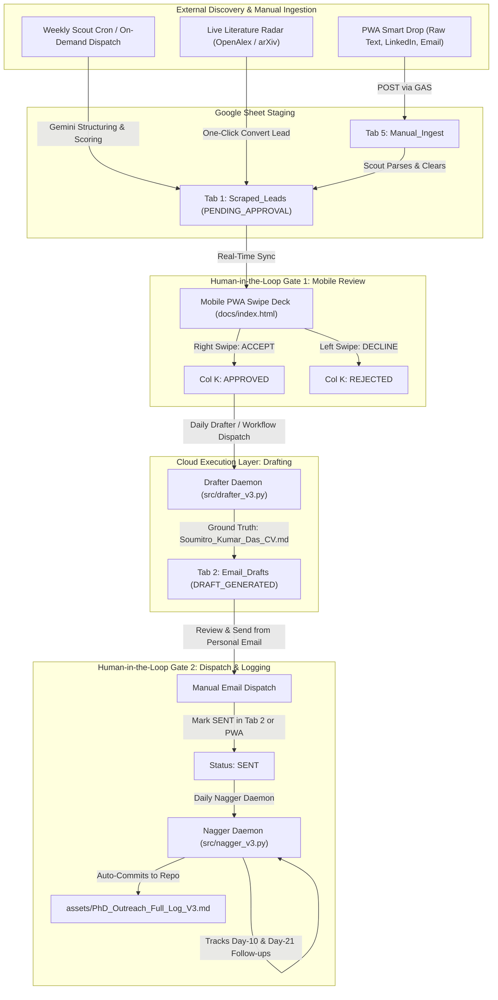

# Autonomous PhD Outreach & Literature Radar Pipeline (v3.7 Guarded Cloud-Native Specification)

**Target Researcher:** Soumitro Kumar Das (Shuvro)  
**Affiliation:** University of Rajshahi, Bangladesh  
**Target PhD Intake:** Fall 2027 (Primary: September 2027 / Secondary: January 2027)  
**Core Fields:** Biomathematics, Mathematical Epidemiology, Fractional-Order Dynamical Systems (Caputo / Caputo-Fabrizio), PINNs, Parameter Estimation & Identifiability  
**System Architecture:** 100% "Laptop-Off" Cloud Execution (GitHub Actions) + **Strict Two-Stage Human-in-the-Loop Verification Firewall** + Universal Dynamic Gemini Model Waterfall + OpenAlex/arXiv Zero-Hallucination Radar + Mobile PWA Command Center  
**Release Version:** v3.7.0-PROD  
**Active Branch:** `Smain`  
**Deployment Directory:** `D:\AI\phd-pipeline-v3\`  

---

## 📑 Table of Contents
1. [The v3.7 Paradigm: Absolute Human-in-the-Loop Control](#1-the-v37-paradigm-absolute-human-in-the-loop-control)
2. [Universal Dynamic Gemini Model Auto-Discovery & Waterfall Fallback](#2-universal-dynamic-gemini-model-auto-discovery--waterfall-fallback)
3. [Five-Tab Cloud Spreadsheet Architecture](#3-five-tab-cloud-spreadsheet-architecture)
4. [Research Intelligence & Biomathematics Literature Radar (Tab 3)](#4-research-intelligence--biomathematics-literature-radar-tab-3)
5. [End-to-End Workflow & Verification Gates](#5-end-to-end-workflow--verification-gates)
6. [Smart Drop Ingestion Engine (Tab 5)](#6-smart-drop-ingestion-engine-tab-5)
7. [Cloud Daemon Specifications (`src/`)](#7-cloud-daemon-specifications-src)
8. [Security Architecture & The PWA Proxy Posture](#8-security-architecture--the-pwa-proxy-posture)
9. [Local Data Sovereignty & Auto-Committing Markdown Logger](#9-local-data-sovereignty--auto-committing-markdown-logger)
10. [Candidate Ground Truth (Single Source of Truth)](#10-candidate-ground-truth-single-source-of-truth)
11. [Fit Scoring Rubric, Missing-Paper Fallback & Deadlines](#11-fit-scoring-rubric-missing-paper-fallback--deadlines)
12. [Email Generation Protocols & Behavioral Rules](#12-email-generation-protocols--behavioral-rules)
13. [Reply Logging & Communication Protocols](#13-reply-logging--communication-protocols)
14. [Mobile PWA Command Center (`/docs`)](#14-mobile-pwa-command-center-docs)
15. [Repository Hierarchy & Clean Directory Tree](#15-repository-hierarchy--clean-directory-tree)
16. [Environment Variables & GitHub Secrets Reference Guide](#16-environment-variables--github-secrets-reference-guide)

---

## 1. The v3.7 Paradigm: Absolute Human-in-the-Loop Control

To eliminate all risks of AI hallucination, unverified paper citations, or over-personalized robotic tone, the pipeline enforces a **Strict Two-Stage Human-in-the-Loop Verification Firewall**:

1. **Stage 1 (Discovery & Vetting):** The automated Scout scans portals, academic databases, and OpenAlex across 5 mathematical biology query clusters. It deposits raw scraped leads into **Tab 1 (`Scraped_Leads`)**. No email drafts are ever created at this stage.
2. **Stage 2 (Manual Tinder-Style Gate):** You review the lead on your phone via the Mobile PWA (`docs/index.html`) or directly in Google Sheets. Swiping right (`ACCEPT`) or left (`DECLINE`) sets the status.
3. **Stage 3 (Draft Generation):** Only rows marked `APPROVED` are processed by the Drafter daemon, which generates the tailored email, checklist, and CV advice into **Tab 2 (`Email_Drafts`)**.
4. **Stage 4 (Manual Dispatch & Reply Tracking):** You review the draft in Tab 2, edit or copy it, dispatch it yourself from your personal email client, mark it **`SENT`**, and let the Nagger daemon automate follow-up cadences and reply sentiment analysis.

---

## 2. Universal Dynamic Gemini Model Auto-Discovery & Waterfall Fallback

In `v3.7`, both the Google Apps Script proxy (`Code.gs`) and the Python backend (`src/cloud_shared_core.py`) incorporate an **automated, version-sorted Gemini discovery and self-healing waterfall engine**:

- **Zero-Latency Winner Caching:**
  - `Code.gs` caches the working model in `CacheService.getScriptCache()` under `BEST_GEMINI_MODEL` for **6 hours** (`21600` seconds).
  - Python daemons cache the winning model in memory (`_CACHED_WORKING_MODEL`). Repeat requests execute immediately without discovery overhead.
- **Dynamic API Model Auto-Discovery:**
  - Queries Google AI Studio's `v1beta/models` endpoint.
  - Automatically filters models where `supportedGenerationMethods` includes `generateContent` and the model name begins with `models/gemini-`.
  - Excludes specialized non-text or multi-modal endpoints (`embedding`, `imagen`, `veo`, `tts`, `audio`, `live`, `vision`, `banana`, `robotics`, `computer-use`).
- **Version-Descending Sorting & Flash Prioritization:**
  - Dynamically extracts and sorts models descending by version number ($3.8 > 3.6 > 3.5 > 3.1 > 2.5 > 2.0 > 1.5$).
  - Prioritizes standard `-flash` over `-lite` or `-pro` variants within the same version tier.
  - Prepends a high-priority fallback cascade: `["models/gemini-3.8-flash", "models/gemini-3.6-flash", "models/gemini-3.5-flash-lite", "models/gemini-3.1-flash-lite", "models/gemini-2.0-flash", "models/gemini-1.5-flash", "models/gemini-1.5-pro"]`.
- **Reasoning Token Filtering:**
  - Strips thinking/reasoning blocks (`parts.filter(p => !p.thought && p.text)` in JS; `not p.get("thought")` in Python) to ensure clean, publication-grade academic prose without intermediate chain-of-thought leakage.
- **Graceful Deterministic Fallback:**
  - If no `GEMINI_API_KEY` is configured or if all models are temporarily unavailable/rate-limited, the system falls back to deterministic biomathematical synthesis (Caputo fractional memory, Dengue ODE carrying-capacity models, and PINN parameter estimation) without interrupting the pipeline.

---

## 3. Five-Tab Cloud Spreadsheet Architecture

- **Master Sheet ID:** `18ww6rPcncVtwDNnHLborAwraY0PNqQr0wsY16gr9M1E`
- **Spreadsheet URL:** [Open Master Google Sheet](https://docs.google.com/spreadsheets/d/18ww6rPcncVtwDNnHLborAwraY0PNqQr0wsY16gr9M1E/edit)

| Tab Name | Purpose | Write Access |
|---|---|---|
| **Tab 1: `Scraped_Leads`** | Pending queue from Scout & Smart Drop | Scout, PWA Swipe decisions |
| **Tab 2: `Email_Drafts`** | Active outreach, drafted by AI, manually dispatched, tracked by Nagger | Drafter, Nagger, Manual Sent |
| **Tab 3: `Literature_Radar`** | Biomathematics research intelligence feed (24h / 7d / 30d OpenAlex & arXiv) | Scholar Radar, PWA Live Fetch |
| **Tab 4: `Archive_History`** | Vault for closed, declined, expired, or completed leads | Nagger / Manual Archive |
| **Tab 5: `Manual_Ingest`** | Staging area for raw unformatted text dropped from PWA | PWA Smart Drop, Scout (Consumer) |

---

## 4. Research Intelligence & Biomathematics Literature Radar (Tab 3)

The **Literature Radar** module provides real-time scholarly tracking and one-click lead generation:

1. **5 Structured Biomathematics Clusters:**
   - **Cluster A (Epidemiology & Compartmental ODEs):** `compartmental model`, `SEIR`, `SIR model`, `infectious disease modeling`, `dengue`, `basic reproduction number`, `bifurcation`.
   - **Cluster B (Parameter Estimation & Inverse Problems):** `parameter estimation`, `epidemic`, `biological`, `differential equations`, `identifiability`, `Bayesian inference`.
   - **Cluster C (PINNs & SciML in Biology):** `Physics-Informed Neural Networks`, `PINNs`, `Neural ODEs`, `dynamical systems`.
   - **Cluster D (Fractional-Order Differential Equations):** `fractional differential equations`, `fractional calculus`, `Caputo`, `mathematical biology`, `epidemiology`.
   - **Cluster E (Predator-Prey, Chemostat & Ecological Systems):** `predator-prey`, `harvesting model`, `chemostat`, `bifurcation analysis`, `stability`.

2. **Live Lookback Windows:** Fetches preprints and articles published within the last **24 Hours**, **7 Days**, or **30 Days** directly via OpenAlex and arXiv.
3. **One-Click Author Conversion (`convert_paper_to_lead`):** Converts the primary author of any high-impact paper into a vetted candidate lead in Tab 1 (`Scraped_Leads`), linking the verified DOI directly into the candidate profile.
4. **Radar Annotations (`save_radar_note`):** Allows persisting qualitative research notes, ideas, or hypotheses per paper directly to the sheet and local storage.

---

## 5. End-to-End Workflow & Verification Gates



---

## 6. Smart Drop Ingestion Engine (Tab 5)

The **Smart Drop** feature allows zero-friction ingestion of ad-hoc opportunities encountered outside scheduled scans:

1. **User Action:** You encounter a PhD call on LinkedIn, an academic mailing list, or a professor's lab website.
2. **One-Tap Drop:** Paste the unformatted text into the PWA's **Smart Drop** tab.
3. **Staging:** The PWA dispatches the raw text to **Tab 5 (`Manual_Ingest`)** via the Google Apps Script API.
4. **Autonomous Structuring:** `scout_v3.py` detects unprocessed rows in Tab 5, extracts the PI Name, University, Department, Deadlines, and Links, queries OpenAlex for recent papers, populates **Tab 1 (`Scraped_Leads`)**, and marks Tab 5 as processed.

---

## 7. Cloud Daemon Specifications (`src/`)

### 7.1 `src/scout_v3.py` (Discovery & Ingestion)
- **Schedule:** Every Friday at 06:00 AM Asia/Dhaka (`0 0 * * 5` UTC) and on-demand via workflow dispatch.
- **Execution:** Scrapes academic portals, parses Tab 5 (`Manual_Ingest`), queries OpenAlex across 5 biomathematics clusters, and computes compatibility fit scores.
- **Safety Rule:** Writes strictly to Tab 1 with `Status = PENDING_APPROVAL`. Never drafts emails or accesses mail clients.

### 7.2 `src/drafter_v3.py` (Ground-Truth Constrained Drafter)
- **Schedule:** Daily at 08:00 AM Asia/Dhaka (`0 2 * * *` UTC).
- **Execution:** Reads Tab 1 for rows where `Status == "APPROVED"`. Injects `assets/Soumitro_Kumar_Das_CV.md` as candidate ground truth.
- **Output:** Generates a 240–310 word tailored cold email, subject line, and pre-send checklist into Tab 2 (`Email_Drafts`).

### 7.3 `src/nagger_v3.py` (Follow-Up Cadence & Sovereign Logger)
- **Schedule:** Daily at 09:00 AM Asia/Dhaka (`0 3 * * *` UTC).
- **Execution:** Monitors Tab 2 for rows marked `SENT`. Calculates follow-up dates (F1: Day 10, F2: Day 21). Analyzes sentiment in Column I (`Reply Summary / Notes`).
- **Data Sovereignty:** Appends all dispatched emails and logged replies to `assets/PhD_Outreach_Full_Log_V3.md` and triggers an auto-commit back to the `Smain` branch.

### 7.4 `src/scholar_radar_v3.py` (Research Intelligence Feed)
- **Schedule:** Every Sunday at 07:00 AM Asia/Dhaka (`0 1 * * 0` UTC) and on-demand.
- **Execution:** Queries OpenAlex and arXiv for 24h, 7d, or 30d papers across Soumitro's 5 biomathematics clusters, synthesizes research gap extension hypotheses, and appends records to Tab 3 (`Literature_Radar`).

### 7.5 `src/fix_profiles.py` (Retroactive Profile Link Resolution)
- **Execution:** Scans Tab 2 (`Email_Drafts`) and Tab 4 (`Archive_History`) to resolve unspecific Google Scholar search URLs into direct, canonical OpenAlex author URLs.

### 7.6 `src/test_pipeline.py` (Automated End-to-End Self-Tester)
- **Execution:** Tests live Google Apps Script Web App endpoints, metadata integrity, dispatched records aggregation, deadlines queue, chatbot proxy, and sheet audits.

---

## 8. Security Architecture & The PWA Proxy Posture

The frontend mobile interface is designed with a **Zero-Secret Public Architecture**:

```
+-----------------------------------+
|  Mobile PWA (GitHub Pages)        |
|  - Static HTML/JS (docs/index.html)
|  - ZERO Secrets Stored in Source  |
|  - XSS Protection: esc() & safeUrl()
|  - Double-Tap Lock: isBusy flag   |
+-----------------+-----------------+
                  | Authenticated POST
                  | (PHD_APP_SECRET via Body)
                  v
+-----------------+-----------------+
|  Google Apps Script (GAS) Proxy   |
|  - Validates APP_SECRET Token     |
|  - Read/Write to Google Sheet     |
|  - Holds GITHUB_PAT Server-Side   |
|  - Relays Workflow Dispatches     |
+-----------------+-----------------+
                  |
                  v
+-----------------+-----------------+
|  GitHub Actions (Smain)           |
|  - 100% Cloud Cron Backend        |
|  - Secret Masking in Logs         |
|  - Ephemeral Runner Environment   |
+-----------------------------------+
```

- **Zero Exposed Keys:** The PWA contains no GitHub tokens, Google Service Account credentials, or private keys.
- **Proxy Authentication:** All writes and workflow triggers route through the Google Apps Script Web App requiring an `APP_SECRET` token configured once via the PWA settings gear (⚙️).
- **XSS & Link Security:** Input variables are sanitized using `esc()` and external links are validated with `safeUrl()` to prevent JavaScript URI injection.

---

## 9. Local Data Sovereignty & Auto-Committing Markdown Logger

To prevent vendor lock-in with cloud spreadsheets and maintain a local, searchable archive of all academic correspondence, the pipeline implements **Local Data Sovereignty**:

1. **Automatic Markdown Logging:** Whenever `nagger_v3.py` detects a `SENT` email or logs a professor reply in Tab 2, it appends a structured entry to `assets/PhD_Outreach_Full_Log_V3.md`.
2. **Git Auto-Commit:** The GitHub Actions workflow automatically stages, commits, and pushes this file back to the `Smain` branch using a bot identity.
3. **Local Sync:** To update your local knowledge base or personal notes, simply execute:
   ```bash
   git pull origin Smain
   ```

---

## 10. Candidate Ground Truth (Single Source of Truth)

All email drafting and compatibility scoring reads directly from **`assets/Soumitro_Kumar_Das_CV.md`** as the single source of truth:

- **Candidate:** Soumitro Kumar Das (Shuvro), Applied Mathematician, University of Rajshahi, Bangladesh.
- **Target Intake:** Fall 2027 (Primary: September 2027 / Secondary: January 2027).
- **Core Research Pillars:**
  1. Fractional-Order Differential Equations (Caputo, Caputo-Fabrizio).
  2. Mathematical Epidemiology (Dengue, Vector-Borne, COVID-19).
  3. Physics-Informed Neural Networks (PINNs) & Parameter Estimation.
- **Published Articles:**
  - *"Role of Carrying Capacity in Dengue Control: A Mathematical Model on Waste Management and Public Awareness"*, Arab Journal of Basic and Applied Sciences (Q1, Scopus CiteScore 4.5, Taylor & Francis).
  - DOI: `10.1080/25765299.2026.2651569` | GitHub: `SoumitroDas/dengue-carrying-capacity-model-simulations`

---

## 11. Fit Scoring Rubric, Missing-Paper Fallback & Deadlines

### 10-Point Fit Rubric
Each opportunity is scored across five criteria (0–2 points each):
1. **Funding ($S_{\text{funding}}$):** Explicit full tuition waiver + livable graduate stipend.
2. **Eligibility ($S_{\text{eligibility}}$):** International applicants explicitly eligible.
3. **Timeline ($S_{\text{timeline}}$):** Aligns with Fall 2027 intake (or rolling admission).
4. **Methodology ($S_{\text{methods}}$):** Synergy with compartmental ODEs/FODEs, fractional calculus, PINNs, or parameter estimation.
5. **Activity ($S_{\text{activity}}$):** $\ge 2$ peer-reviewed papers in 2024–2026, active grants, history of international students.

### Missing-Paper Fallback Handling
- If recent paper metadata is missing from OpenAlex, the Scout scores the lead based on verified institutional laboratory descriptions and flags the lead with `Paper: Institutional Review Required`.
- The Drafter automatically selects Email Structure `S3` (Profile-Only) or `S4` (Short Inquiry) rather than hallucinating paper citations.

---

## 12. Email Generation Protocols & Behavioral Rules

- **Word Count:** Strictly constrained between 240 and 310 words.
- **Approved Structure Tags:**
  - `S1`: Independent research proposal linked to PI's broader framework.
  - `S2`: Literature-linked (references candidate's published Dengue paper and PI's recent work).
  - `S3`: Profile-only outreach (used when specific paper DOIs are unavailable).
  - `S4`: Short concise inquiry.
- **Strictly Banned Phrasing (Anti-AI Clichés):**
  - ❌ *"I hope this email finds you well"*
  - ❌ *"I am writing to express my keen interest / enthusiastic interest"*
  - ❌ *"delve"*, *"tapestry"*, *"testament"*, *"beacon"*, *"plethora"*
  - ❌ *"I would be deeply honored to join your prestigious laboratory"*
  - ❌ *"structural bottleneck... this specific limitation draws me directly to your work"*

---

## 13. Reply Logging & Communication Protocols

1. **PWA Quick Reply (Mobile):** Tap the **Replies** pill in the PWA, enter the professor's name, select a category (`Positive`, `Neutral`, `Redirect`, `Declined`), paste snippet notes, and submit.
2. **Spreadsheet Paste (Direct):** Paste professor responses directly into **Tab 2, Column I (`Reply Summary / Notes`)**.
3. **Automated Parsing:** The daily `nagger_v3` daemon automatically classifies the response, stops follow-up timers for positive/declined threads, and updates `assets/PhD_Outreach_Full_Log_V3.md`.

---

## 14. Mobile PWA Command Center (`/docs`)

Hosted entirely on GitHub Pages from the `/docs` directory:

- **True AMOLED Dark Mode:** Tailwind CSS dark palette optimized for mobile OLED screens.
- **Clean Priority Filtering:** Single header dropdown (`modalPrioritySelect`) supporting All Priorities, P1 - High, P2 - Medium, P3 - Low, and P4 - Dormant.
- **Explicit Copyable Emails:** The professor's email is always rendered with a one-click copy button and toast notification.
- **Intelligent Profile Resolution:** Automatic fallback to canonical OpenAlex author search (`&type=author`) when generic Google Scholar queries are present.
- **Tinder-Style Swipe UI:** Review scraped leads with left/right touch gestures with a 160px drag threshold.
- **Offline Reliability:** Service Worker (`docs/sw.js` cache `phd-command-v3-cache-v21`) for seamless review.

---

## 15. Repository Hierarchy & Clean Directory Tree

```
D:\AI\phd-pipeline-v3\
│
├── .github\
│   └── workflows\
│       └── phd_pipeline_v3.yml         # GitHub Actions 4-cron serverless pipeline (Smain branch)
│
├── assets\
│   ├── drive_config.json               # Cloud IDs for Google Drive & Master Sheet
│   ├── email_structures.md             # Email style rules and structure tag reference
│   ├── PhD_Outreach_Full_Log_V3.md     # Auto-committing Markdown outreach & reply log
│   └── Soumitro_Kumar_Das_CV.md        # Single Source of Truth: Academic CV ground truth
│
├── docs\                               # GitHub Pages PWA Root
│   ├── 404.html                        # SPA routing fallback mirror
│   ├── index.html                      # Mobile PWA Command Center application
│   ├── manifest.json                   # Web App Manifest
│   └── sw.js                           # Offline caching Service Worker (v21)
│
├── local_auth\                         # Local developer authentication (Git-Ignored)
│   ├── credentials.json                # Google Cloud OAuth client secret template
│   ├── setup_oauth.py                  # One-time local OAuth token generator
│   └── token.json                      # Refresh token (base64-encoded to GitHub Secrets)
│
├── src\                                # Cloud Python Backend
│   ├── cloud_shared_core.py            # Gemini waterfall router, Sheets, Drive, OpenAlex client
│   ├── drafter_v3.py                   # Daily Drafter daemon (Populates Tab 2)
│   ├── fix_profiles.py                 # Retroactive OpenAlex author profile resolver
│   ├── nagger_v3.py                    # Daily Sent monitor, follow-up tracker & markdown logger
│   ├── optimize_sheet_v34.py           # Sheet deduplication & column schema optimizer
│   ├── scholar_radar_v3.py             # Sunday & on-demand Literature Radar daemon
│   ├── scout_v3.py                     # Friday Portal, LinkedIn & Tab 5 Ingest Scout daemon
│   └── test_pipeline.py                # Automated end-to-end self-tester suite
│
├── .gitignore                          # Excludes secrets, tokens, logs, and compiled caches
├── cleanup.ps1                         # PowerShell temporary cache and compiler purger
├── Code.gs                             # Google Apps Script Web App Backend Proxy (v3.7)
├── README.md                           # Master technical specification & architecture manual
└── requirements.txt                    # Cloud execution dependencies
```

---

## 16. Environment Variables & GitHub Secrets Reference Guide

To ensure zero-leakage security, actual secrets and tokens are never committed to source control. They are managed through GitHub Repository Secrets and Google Apps Script Script Properties:

| Secret / Property Name | Platform | Description |
|---|---|---|
| `GEMINI_API_KEY` | GitHub Secrets & Apps Script | Google AI Studio API key for dynamic model waterfall and reasoning. |
| `PHD_GAS_URL` | GitHub Secrets & PWA Settings | Web App URL of the deployed Google Apps Script proxy (`Code.gs`). |
| `PHD_APP_SECRET` | GitHub Secrets, Apps Script & PWA | Shared authentication passphrase securing the Apps Script proxy. |
| `GOOGLE_TOKEN_JSON_B64` | GitHub Secrets | Base64-encoded Google OAuth token for direct Sheets mutations (optional). |
| `TELEGRAM_BOT_TOKEN` | GitHub Secrets | Telegram Bot API token for dispatch notifications (optional). |
| `TELEGRAM_CHAT_ID` | GitHub Secrets | Personal Telegram chat ID for alert delivery (optional). |
| `GITHUB_PAT` | Apps Script Properties | Personal Access Token allowing Apps Script to dispatch GitHub workflows. |

---
*Autonomous PhD Outreach & Literature Radar Pipeline v3.7 — Guarded Human-in-the-Loop Architecture.*
