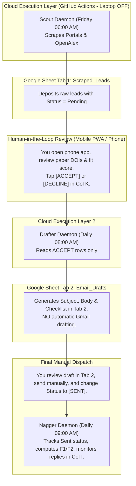

# Autonomous PhD Outreach & Literature Radar Pipeline (v3.1 Guarded Cloud-Native Specification)

**Target Researcher:** Soumitro Kumar Das (Shuvro)  
**Affiliation:** University of Rajshahi, Bangladesh  
**Target PhD Intake:** January 2027 (Secondary: September 2027)  
**Core Fields:** Biomathematics, Mathematical Epidemiology, Fractional-Order Dynamical Systems (Caputo / Caputo-Fabrizio), PINNs, Parameter Estimation & Identifiability  
**System Architecture:** 100% "Laptop-Off" Cloud Execution (GitHub Actions) + **Strict Two-Stage Human-in-the-Loop Verification Firewall** + OpenAlex/arXiv Zero-Hallucination Radar + Mobile PWA Command Center  
**Release Version:** v3.1.0-PROD  
**Deployment Directory:** `D:\AI\phd-pipeline-v3\`  

---

## 📑 Table of Contents
1. [The v3.1 Paradigm: Absolute Human-in-the-Loop Control](#1-the-v31-paradigm-absolute-human-in-the-loop-control)
2. [Three-Tab Cloud Spreadsheet Architecture](#2-three-tab-cloud-spreadsheet-architecture)
3. [End-to-End Workflow & Verification Gates](#3-end-to-end-workflow--verification-gates)
4. [Cloud Daemon Specifications (`src/`)](#4-cloud-daemon-specifications-src)
5. [Candidate Ground Truth & Academic Credentials](#5-candidate-ground-truth--academic-credentials)
6. [Fit Scoring Rubric & Anti-Hallucination Rules](#6-fit-scoring-rubric--anti-hallucination-rules)
7. [Email Generation Protocols & Behavioral Rules](#7-email-generation-protocols--behavioral-rules)
8. [Reply Logging & Communication Protocols](#8-reply-logging--communication-protocols)
9. [Mobile PWA Command Center (`/docs`)](#9-mobile-pwa-command-center-docs)
10. [Repository Hierarchy & Clean Directory Tree](#10-repository-hierarchy--clean-directory-tree)
11. [Step-by-Step Setup & Deployment Runbook](#11-step-by-step-setup--deployment-runbook)
12. [GitHub Secrets Reference Guide](#12-github-secrets-reference-guide)
13. [Emergency Diagnostic Playbook](#13-emergency-diagnostic-playbook)

---

## 1. The v3.1 Paradigm: Absolute Human-in-the-Loop Control

To eliminate all risks of AI hallucination, unverified paper citations, or over-personalized robotic tone, v3.1 introduces a **Strict Two-Stage Verification Firewall**:

1. **Stage 1 (Discovery & Vetting):** The automated Scout scans portals, LinkedIn, and OpenAlex. It deposits raw scraped leads into **Tab 1 (`Scraped_Leads`)**. No email drafts are ever created at this stage.
2. **Stage 2 (Manual Gate):** You review the lead on your Android phone via the PWA or Google Sheets. You select **`ACCEPT`** or **`DECLINE`** in Column K.
3. **Stage 3 (Draft Generation):** Only rows marked `ACCEPT` are processed by the Drafter daemon, which generates the tailored email, checklist, and CV advice into **Tab 2 (`Email_Drafts`)**.
4. **Stage 4 (Manual Dispatch & Reply Tracking):** You read the draft in Tab 2, edit or copy it, send it yourself from your personal email client, mark it **`SENT`**, and manage incoming replies through dedicated logging columns.

---

## 2. Three-Tab Cloud Spreadsheet Architecture

- **Master Sheet ID:** `18ww6rPcncVtwDNnHLborAwraY0PNqQr0wsY16gr9M1E`
- **Spreadsheet URL:** [Open Master Sheet](https://docs.google.com/spreadsheets/d/18ww6rPcncVtwDNnHLborAwraY0PNqQr0wsY16gr9M1E/edit)

### Tab 1: `Scraped_Leads` (Discovery & Vetting)
* `Date Found` (Col A)
* `PI Name` (Col B)
* `Institution` (Col C)
* `Department` (Col D)
* `Opportunity Title` (Col E)
* `Posting Link` (Col F)
* `OpenAlex Verified Paper 1 & DOI` (Col G)
* `OpenAlex Verified Paper 2 & DOI` (Col H)
* `Fit Score` (Col I)
* `Deadline` (Col J)
* **`Your Decision (ACCEPT / DECLINE)`** (Col K) — *The manual firewall gate.*

### Tab 2: `Email_Drafts` (Staging, Review & Dispatch)
* `Date Drafted` (Col A)
* `PI Name` (Col B)
* `Email` (Col C)
* `Subject Line` (Col D)
* `Full Email Body` (Col E)
* `Pre-Send Checklist & CV Advice` (Col F)
* **`Dispatch Status (DRAFT / SENT)`** (Col G)
* **`PI Reply Status (No Reply / Positive / Neutral / Declined)`** (Col H)
* **`Reply Summary / Notes`** (Col I) — *Paste professor replies here for automated log updates.*
* `F1 Due` / `F2 Due` (Cols J & K)

### Tab 3: `Literature_Radar` (Sunday Research Feed)
* Weekly verified papers, methodology breakdowns, and mathematical epidemiology research mix ideas (OpenAlex/arXiv verified).

---

## 3. End-to-End Workflow & Verification Gates



---

## 4. Cloud Daemon Specifications (`src/`)

### 4.1 `src/scout_v3.py`
- **Trigger:** Every Friday at 06:00 AM Asia/Dhaka.
- **Action:** Scrapes portals, LinkedIn, and OpenAlex. Appends rows exclusively to **Tab 1 (`Scraped_Leads`)** with the decision column set to `Pending`.
- **Safety Rule:** Never triggers email generation or Gmail access.

### 4.2 `src/drafter_v3.py`
- **Trigger:** Daily at 08:00 AM Asia/Dhaka.
- **Action:** Reads Tab 1. Filters strictly for rows where `Col K == "ACCEPT"`.
- **Action:** Generates the email body, subject line, and pre-send checklist using Gemini 2.5 Pro (following structure `S1`-`S4` with strict anti-hallucination checks and banned phrase filters).
- **Action:** Writes the compiled content into **Tab 2 (`Email_Drafts`)** as a review buffer.

### 4.3 `src/nagger_v3.py`
- **Trigger:** Daily at 09:00 AM Asia/Dhaka.
- **Action:** Monitors Tab 2 (`Email_Drafts`).
- **Action:** When you update `Dispatch Status` to `SENT`, it calculates Day-10 (F1) and Day-21 (F2) follow-up windows.
- **Action:** Reads **`Col I (Reply Summary / Notes)`**. If you paste a professor's reply here, the daemon parses the sentiment (`Positive`, `Declined`, `Redirect`), updates the tracker, and notifies you via Telegram.

### 4.4 `src/scholar_radar_v3.py`
- **Trigger:** Every Sunday at 07:00 AM Asia/Dhaka.
- **Action:** Queries OpenAlex and arXiv APIs for verified biomathematics publications. Appends weekly research mix ideas to **Tab 3 (`Literature_Radar`)**.

---

## 5. Candidate Ground Truth & Academic Credentials

All autonomous draft generation is constrained by the ground-truth credentials defined in `cloud_shared_core.py`:
- **Candidate:** Soumitro Kumar Das (Shuvro), applied mathematician, University of Rajshahi, Bangladesh.
- **Target Intake:** January 2027 (Secondary: September 2027).
- **Published Article:** *"Role of Carrying Capacity in Dengue Control: A Mathematical Model on Waste Management and Public Awareness"*, Arab Journal of Basic and Applied Sciences (Q1, Scopus CiteScore 4.5).
  - DOI: `https://doi.org/10.1080/25765299.2026.2651569`
  - GitHub: `https://github.com/SoumitroDas/dengue-carrying-capacity-model-simulations`
- **Under Review Articles:** 
  1. Fractional-order COVID-19 variant modeling using Caputo derivative and Adams-Bashforth-Moulton method.
  2. Data-driven routine analysis for student mental health using ML.
- **Technical Stack:** MATLAB, Python (NumPy, SciPy, Scikit-learn, PyTorch), Mathematica, C/C++, parameter identifiability, PINNs, fractional calculus (Caputo, Caputo-Fabrizio).

---

## 6. Fit Scoring Rubric & Anti-Hallucination Rules

Every opportunity is scored on a 10-point scale across five criteria (0–2 points each):
1. **Funding ($S_{\text{funding}}$):** Fully funded stipend + full tuition waiver explicitly covered.
2. **Eligibility ($S_{\text{eligibility}}$):** Bangladeshi / overseas applicants explicitly eligible.
3. **Timeline ($S_{\text{timeline}}$):** Start date January 2027 or rolling admission.
4. **Methods ($S_{\text{methods}}$):** Direct fit with compartmental ODEs, fractional calculus, PINNs, or parameter estimation.
5. **Activity ($S_{\text{activity}}$):** $\ge 2$ papers in 2024–2026, active grants, history of international students.

**Hard Reject Keywords:** Any lead mentioning `"self-funding"`, `"tuition fees apply"`, `"home students only"`, or `"domestic students only"` is discarded immediately.

---

## 7. Email Generation Protocols & Behavioral Rules

- **Strict Length:** Between 240 and 310 words.
- **Structure Tags:** Permitted structures `S1` (Independent background), `S2` (Literature-linked), `S3` (Profile-only), `S4` (Short inquiry).
- **Strictly Banned Phrasing:**
  - ❌ *"I hope this email finds you well"*
  - ❌ *"I am writing to express my keen interest / enthusiastic interest"*
  - ❌ *"delve"*, *"tapestry"*, *"testament"*, *"beacon"*
  - ❌ *"I would be deeply honored to join your prestigious laboratory"*
  - ❌ *"structural bottleneck... this specific limitation draws me directly to your work"*

---

## 8. Reply Logging & Communication Protocols

1. **The Spreadsheet Method (Primary):** When a professor replies to your personal email, copy their text snippet and paste it directly into **Tab 2, Column I (`Reply Summary / Notes`)** on your phone.
2. **The Automated Parse:** The daily `nagger_v3` daemon reads Column I, categorizes the outcome (`Positive`, `Declined`, `Redirect`), updates `Column H`, and halts or adjusts follow-up schedules automatically.
3. **The Chat Method (Fallback):** Alternatively, paste the reply into your Antigravity chat session when you are online, and instruct: *"Log this reply for Prof. [Name]."*

---

## 9. Mobile PWA Command Center (`/docs`)

- **Hosting:** Free on GitHub Pages from the `/docs` directory.
- **Android Installation:** Open the GitHub Pages URL in Chrome on your phone ➔ Tap menu (⋮) ➔ **"Add to Home Screen"**.
- **Capabilities:**
  - Switch between Tab 1 (Leads), Tab 2 (Drafts), and Tab 3 (Radar).
  - Open direct deep-links to each tab in the Master Google Sheet.
  - Review drafts and checklists comfortably on mobile.

---

## 10. Repository Hierarchy & Clean Directory Tree

```
D:\AI\phd-pipeline-v3\
│
├── .github\
│   └── workflows\
│       └── phd_pipeline_v3.yml         # GitHub Actions 4-cron serverless pipeline
│
├── assets\
│   ├── drive_config.json               # Cloud IDs for Google Drive & Master Sheet
│   ├── email_structures.md             # Email style rules and structure tag reference
│   ├── PhD_Outreach_Full_Log_V3.md     # Auto-committing Markdown outreach & reply log
│   └── Soumitro_Kumar_Das_CV.md        # Single Source of Truth: Academic CV ground truth
│
├── docs\                               # GitHub Pages PWA Root
│   ├── 404.html                        # SPA routing fallback
│   ├── index.html                      # Mobile PWA Command Center application
│   ├── manifest.json                   # Web App Manifest
│   └── sw.js                           # Offline caching Service Worker
│
├── src\                                # Cloud Python Backend
│   ├── cloud_shared_core.py            # Shared clients: Gemini LLM, Workspace, OpenAlex
│   ├── drafter_v3.py                   # Daily Drafter daemon (Writes to Tab 2)
│   ├── nagger_v3.py                    # Daily Sent monitor & reply parser daemon
│   ├── scholar_radar_v3.py             # Sunday Literature Radar daemon
│   └── scout_v3.py                     # Friday Portal & LinkedIn Scout daemon
│
├── .gitignore                          # Ignores tokens, cache, credentials, and temp files
├── cleanup.ps1                         # PowerShell temporary cache and compiler purger
├── README.md                           # Master technical specification & user manual
└── requirements.txt                    # Cloud dependencies

---
*Autonomous PhD Outreach & Literature Radar Pipeline v3.1 — Guarded Human-in-the-Loop Architecture.*
